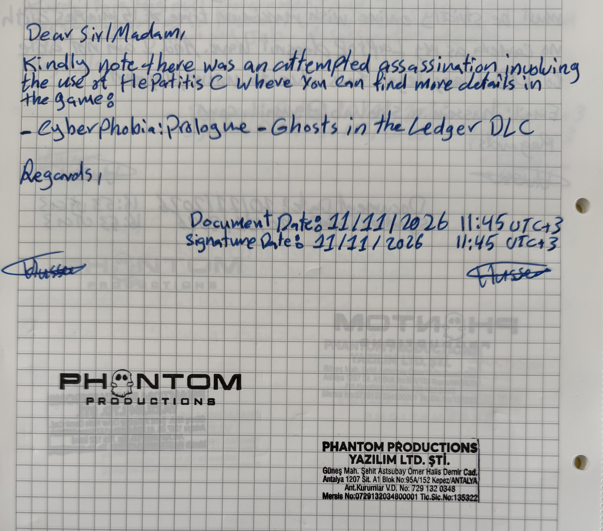

Dear Sir/Madam,

Kindly note there was an attempted assassination involving the use of Hepatitis C, where you can find more details in the game:

- Cyberphobia: Prologue – Ghosts in the Ledger DLC

Regards,

Document Date: 11/11/2026 – 11:45 UTC+3
Signature Date: 21/11/2026 – 11:45 UTC+3

[Signature]

PHANTOM PRODUCTIONS
PRODUCTIONS

PHANTOM PRODUCTIONS
YAZILIM LTD. ŞTİ.

Güneş Mah. Şehit Astsubay Ömer Halis Demir Cad.
Antalya 1207 Sit. A1 Blok No:95A/152 Kepez/ANTALYA

Ant. Kurumlar V.D. No: 729 132 0348
Mersis No: 0729132034800001
Tic. Sic. No: 135322

