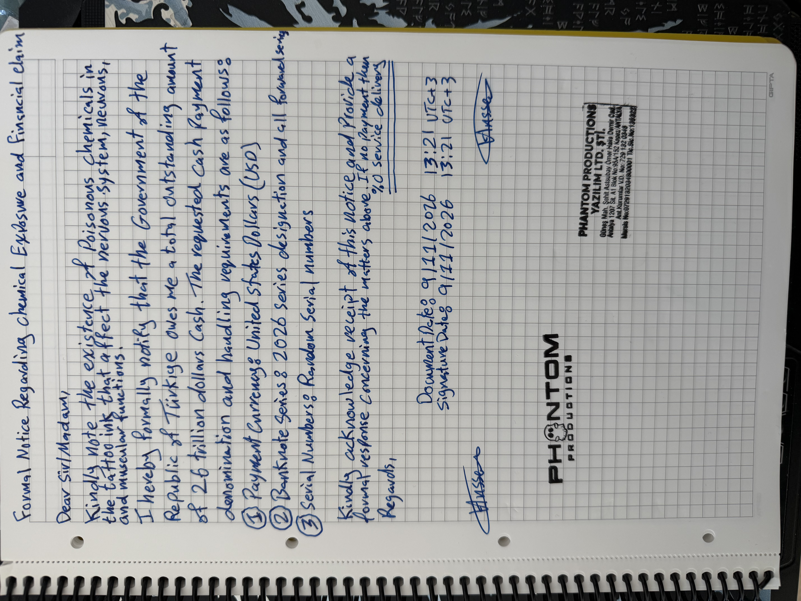
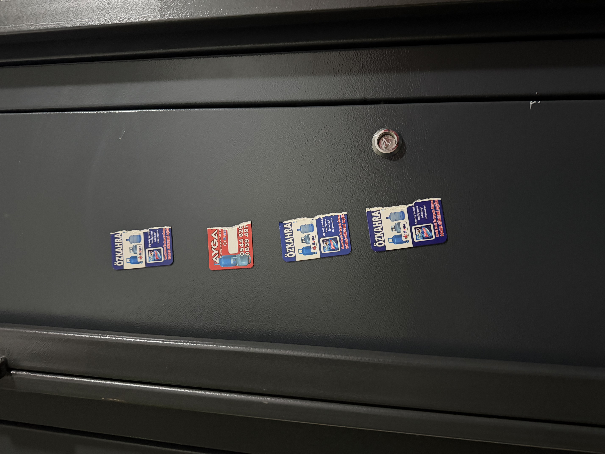

Dear Sir/Madam,
Kindly note the existence of poisonous chemicals in the tattoo ink that affect the nervous system, neurons, and muscular functions.
I hereby formally notify that the Government of the Republic of Türkiye owes me a total outstanding amount of 26 trillion dollars in cash. The requested cash payment denomination and handling requirements are as follows:
Payment Currency: United States Dollars (USD).
Banknote Series: 2026 Series designation and all forward series.
Serial Numbers: Random serial numbers.
Kindly acknowledge receipt of this notice and provide a formal response concerning the matters above. If no payment then %𝟎 𝐬𝐞𝐫𝐯𝐢𝐜𝐞 𝐝𝐞𝐥𝐢𝐯𝐞𝐫𝐲.
Regards,
Document Date: 9/11/2026 – 13:21 (UTC+3)
Signature Date: 9/11/2026 – 13:21 (UTC+3)
Signatures: Hussein (two signatures appear on the document).
Company Stamp (appears twice):
PHANTOM PRODUCTIONS YAZILIM LTD. ŞTİ.
Güneş Mah. Şehit Astsubay Ömer Halis Demir Cad.
Antalya 1207 Sit. A1 Blok No:95A/152 Kepez/ANTALYA
Ant. Kurumlar V.D. No: 729 132 0348
Mersis No: 0729132034800001
Tic. Sic. No: 135322

[Installments]

