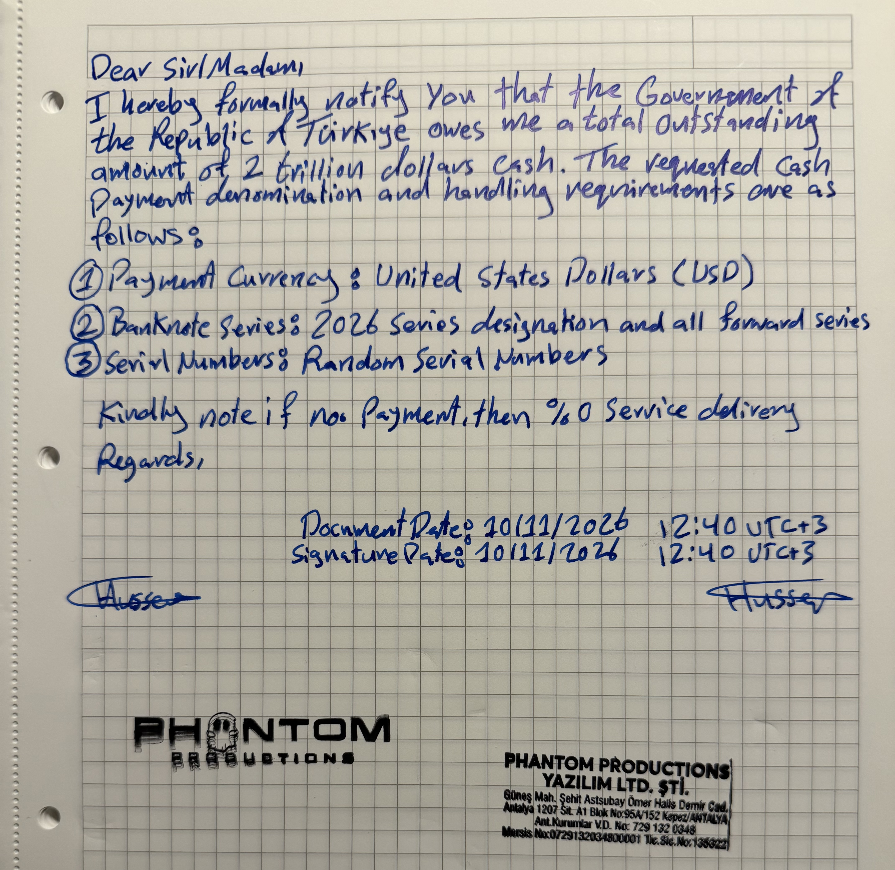

Dear Sir/Madam,
I hereby formally notify you that the Government of the Republic of Türkiye owes me a total outstanding amount of 2 trillion dollars in cash. The requested cash payment denomination and handling requirements are as follows:
Payment Currency: United States Dollars (USD).
Banknote Series: 2026 series designation and all subsequent series.
Serial Numbers: Random serial numbers.
Kindly note that, in the absence of payment, 0% service delivery shall apply.
Regards,
Document Date: 10/11/2026 – 12:40 UTC+3
Signature Date: 10/11/2026 – 12:40 UTC+3
[Handwritten Signature]
PHANTOM PRODUCTIONS YAZILIM LTD. ŞTİ.
Company Stamp (visible text):
PHANTOM PRODUCTIONS
YAZILIM LTD. ŞTİ.
Güneş Mah. Şehit Astsubay Ömer Halis Demir Cad.
Antalya 1207 Sit. A1 Blok No:95A/152 Kepez/ANTALYA
Ant. Kurumlar V.D. No: 729 132 0348
Mersis No: 0729132034800001
Tic. Sic. No: 135322

