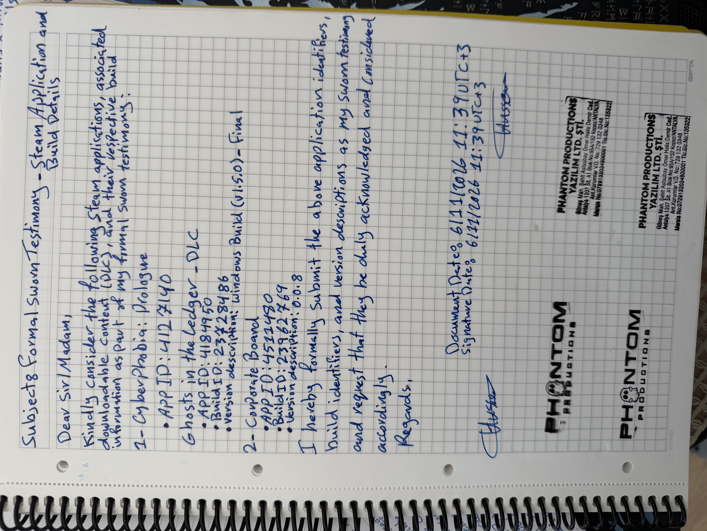

Subject: Formal Sworn Testimony – Steam Application and Build Details

Dear Sir/Madam,

Kindly consider the following Steam applications, associated downloadable content (DLC), and their respective build information as part of my formal sworn testimony:

Cyberphobia: Prologue

App ID: 4127140

Ghosts in the Ledger – DLC

App ID: 4184950

Build ID: 23728486

Version Description: Windows Build (v1.5.0) – Final

Corporate Board

App ID: 4511480

Build ID: 23962769

Version Description: 0.0.8

I hereby formally submit the above application identifiers, build identifiers, and version descriptions as my sworn testimony and request that they be duly acknowledged and considered accordingly.

Regards,

Hussein's Signature

Document Date: 06/11/2026 – 11:39 UTC+3

Signature Date: 06/11/2026 – 11:39 UTC+3

Signatures: Hussein (two signatures appear on the document).

Company Stamp (appears twice):

PHANTOM PRODUCTIONS YAZILIM LTD. ŞTİ.

Güneş Mah. Şehit Astsubay Ömer Halis Demir Cad.

Antalya 1207 Sk. A1 Blok No:95A/152 Kepez/ANTALYA

Ant. Kurumlar V.D. No: 729 132 0348

Mersis No: 07290132034800001

Tic. Sic. No: 135322

