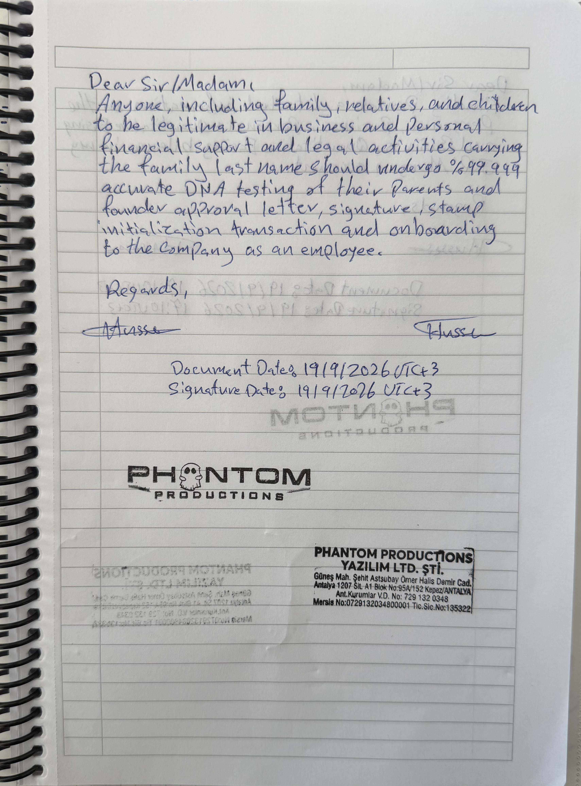

Dear Sir/Madam,
Anyone, including family, relatives, and children, to be legitimate in business and personal financial support and legal activities carrying the family last name, should undergo 99.999% accurate DNA testing of their parents and founder approval letter, signature, stamp, invitation transaction, and onboarding to the company.
Regards,
[Hussein's signature]
[Hussein's signature]
Document Date: 19/9/2026 UTC+3
Signature Date: 19/9/2026 UTC+3
PHANTOM PRODUCTIONS
PHANTOM PRODUCTIONS YAZILIM LTD. ŞTİ.
Güneş Mah. Şehit Astsubay Ömer Halis Demir Cad.
Antalya 1207 Sk. Al-Bir Blok No:95/A/152 Kepez/ANTALYA
Ant. Kurları VD. No: 729 132 0348
Mersis No: 0729132034800001
Tic. Sic. No: 135322

