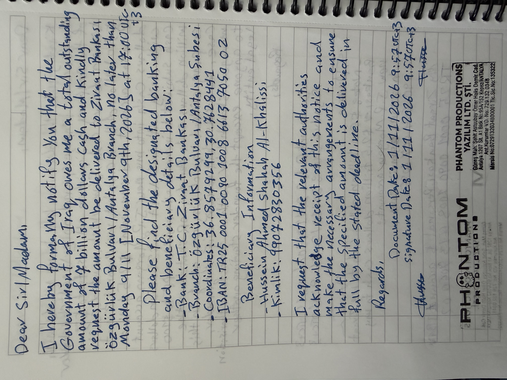

Dear Sir/Madam,
I hereby formally notify you that the Government of Iraq owes me a total outstanding amount of 7 billion dollars in cash and kindly request that the amount be delivered to Ziraat Bankası, Özgürlük Bulvarı / Antalya Branch, no later than Monday, 9/11 [November 9th, 2026] at 17:00 UTC+3.
Please find the designated banking and beneficiary details below:
Banking Information
Bank: T.C. Ziraat Bankası
Branch: Özgürlük Bulvarı / Antalya Şubesi
Coordinates: 36.8579299, 30.7628441
IBAN: TR25 0001 0090 1008 6613 7050 02
Beneficiary Information
Name: Hussein Ahmed Shahab Al-Khalissi
Kimlik: 99072830356
I request that the relevant authorities acknowledge receipt of this notice and make the necessary arrangements to ensure that the specified amount is delivered in full by the stated deadline.
Regards,
Hussein Ahmed Shahab Al-Khalissi
Document Date: 1/11/2026, 9:57 UTC+3
Signature Date: 1/11/2026, 9:57 UTC+3
[Signature]
[Signature]
Company Stamp
PHANTOM PRODUCTIONS YAZILIM LTD. ŞTİ.
Güneş Mah. Şehit Astsubay Ömer Halis Demir Cad.
Antalya 1207 St. A1 Blok No:95A/152 Kepez/ANTALYA
Ant. Kurumlar V.D. No: 729 132 0348
Mersis No: 0729132034800001
Tic. Sic. No: 135322

